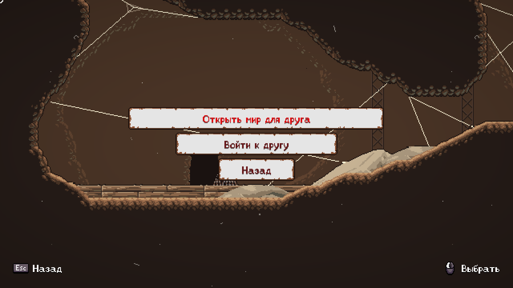

# Webbed Co-op

Неофициальный кооперативный мод для [Webbed](https://store.steampowered.com/app/1390350/Webbed/) на двоих через Steam.
Каждый управляет своим пауком, у каждого своя камера, паутина и физика общие, сюжет идёт по сохранению хоста.

**[Скачать установщик (Webbed-Coop-Setup.exe)](../../releases/latest)**


## Что умеет

- **Свой паук у каждого.** Пауки двигаются независимо, паутину, захват, плетение и разрезание видят оба, и всё это работает в общей физике. Каждый игрок сам считает своего паука и свою паутину, а другому приходит готовый результат: паук друга движется плавно (с запаздыванием 0,1 с) и не дёргается от двойного расчёта.
- **Разные комнаты.** Каждый может уйти в свою комнату и вернуться к другу. Дверь переносит только того, кто в неё вошёл.
- **Общий сюжет.** Флаги истории, задачи, собранные предметы, наклейки, страницы журнала и состояние комнат сводятся в сохранение хоста. Выполненное задание не откатывается, а шаги одного квеста, сделанные двумя игроками параллельно, складываются.
- **Связь через Steam.** Соединение идёт через бесплатное приложение [Porthole](https://store.steampowered.com/app/4963920/) (сеть Steam с ретрансляторами), без LAN, VPN и проброса портов.
- **Сам находит друга.** Хост открывает мир, а друг нажимает «Войти к другу»: мод находит открытый мир среди друзей Steam. Можно и нажать «Присоединиться к игре» в списке друзей Steam. Для игрока не из друзей есть приглашение через буфер обмена.
- **Встроено в игру.** Пункт «Кооператив» стоит в главном меню и меню паузы рядом с «Настройками» и нарисован самой игрой: её таблички, шрифт, курсор и подсказки клавиш.
- **Взаимодействие пауков, в обе стороны.** Можно толкать друг друга, стоять у друга на спине и ехать на нём, цеплять захват и паутину на паука друга, тянуть и поднимать его на нити (нить держит как верёвка и сама не рвётся, перерезать её можно выстрелом). Взаимодействие (F) вплотную к другу — объятия с сердечками, танец рядом — тоже сердечки.
- **Пауза не мешает другу.** В кооперативе меню и журнал открываются поверх идущей игры, мир не останавливается; при потере фокуса игра не встаёт на паузу.
- **Друга видно.** Паук друга подкрашен в его цвет (у хоста зелёный, у гостя синий), над ним стрелка из интерфейса игры. Если друг за краем экрана или в другой комнате, у края экрана появляется стрелка в его сторону, а в журнале на карте стоит его булавка.

| Меню «Кооператив» | Паук друга | Карта в журнале |
|---|---|---|
|  |  |  |

## Установка

Скачайте [`Webbed-Coop-Setup.exe`](../../releases/latest) и запустите. Установщик всё сделает сам:

1. Если Webbed нет, откроет её в Steam (купить или установить) и дождётся конца установки.
2. Найдёт игру в любой библиотеке Steam, проверит версию по контрольным суммам и сохранит резервную копию оригинального `data.win`.
3. Поставит мод. Если Webbed запущена, попросит её закрыть; если игра в `Program Files`, запросит права администратора.
4. Если нет бесплатного [Porthole](https://store.steampowered.com/app/4963920/), предложит открыть его установку в Steam.

Повторный запуск установщика удаляет мод и возвращает исходный `data.win` байт в байт.

Windows может показать синее окно SmartScreen («Windows защитила ваш компьютер»), потому что у файла нет платной цифровой подписи: нажмите «Подробнее» → «Выполнить в любом случае».

## Как играть

Всё делается в меню игры: **Кооператив** есть в главном меню и в паузе. Над кнопками всегда написано, что сейчас происходит и что делать дальше.

**Хост** (чей мир и сохранение):
1. Загрузите сохранение, откройте паузу и выберите **Кооператив → Открыть мир для друга**.
2. Появится «Запускаю Porthole... (5-20 секунд)», затем «Мир открыт · ждём друга». В этот момент приглашение **само копируется в буфер обмена** (вида `WB3/ABCDEF1234/...`).
3. Вставьте его другу в Steam, Discord или Telegram (Ctrl+V). Скопировать ещё раз: **Скопировать приглашение**.

**Гость:**
1. Скопируйте приглашение из сообщения хоста (Ctrl+C). Можно копировать вместе с остальным текстом сообщения: мод сам найдёт в нём код.
2. В главном меню или в паузе выберите **Кооператив → Вставить приглашение**. Появится «Подключение через Steam...», а через 10-30 секунд загрузится мир хоста.
3. Если вы друзья в Steam, можно без копирования: **Найти друга в Steam** или «Присоединиться к игре» в списке друзей Steam.

Выйти: **Кооператив → Покинуть мир друга** (гость) или **Закрыть мир** (хост). Сюжет сохраняется у хоста; игра гостя после выхода перезапускается в его собственное меню, его сохранения не затрагиваются.

Проверить на одном компьютере: запустите две копии игры, в одной откройте мир, в другой нажмите «Вставить приглашение». Дружба в Steam для этого не нужна.

## Как это устроено

- `src/` — нативная часть (C, x86). DLL подключается к игре как расширение GameMaker и перехватывает события объектов: ввод (`oIO`), игрока, камеру, журнал, HUD и меню `oMainMenu`. Пункт «Кооператив» добавляется в массивы `option_labels/option_scripts` самого меню, а подменю — это обычный экземпляр игрового `oMenu`.
- `helper/link.py` — сетевой модуль. Его запускает официальный подписанный `pythonw.exe` от python.org, который установщик кладёт в `WebbedCoop\` рядом с игрой вместе с нужной частью стандартной библиотеки (`python311.zip`, файл `python311._pth` изолирует эту среду от других установок Python). Через общую память получает от игры кадры пауков, физику паутины и изменения сохранения и обменивается ими по TCP. Хост слушает только `127.0.0.1` и открывает порт через `porthole expose` (анонимный режим, пароль из приглашения), гость подключается через `porthole connect`. Каждое сообщение подписано HMAC сеансовым ключом.
- `installer/setup.c` — нативный установщик без упаковщиков: находит игру, проверяет хеши, накладывает разницу на `data.win` (регистрация расширения) и раскладывает файлы. Полезная нагрузка дописана в конец exe скриптом `tools/pack.py`.
- Временные файлы кооператива (`WebbedCoopSnapshot*.sav`, `WebbedCoopGuest*.sav`) лежат в папке, которую синхронизирует Steam Cloud, поэтому мод удаляет их сразу после использования и при запуске игры.

## Сборка

Нужны [Zig](https://ziglang.org/) (компилятор C для расширения игры и установщика) и CPython 3.11 x64 с python.org (его среда идёт вместе с модом):

```powershell
.uild.ps1 -Python "C:\путь\к\Python311"
```

Результат — `dist\Webbed-Coop-Setup.exe`.

## Ограничения

- Проверено на двух копиях игры на одном ПК через настоящий туннель Porthole/Steam: подключение, раздельные комнаты, паутина, предметы, сюжетный флаг, повторное подключение. Полное прохождение кампании вдвоём и игра на двух разных компьютерах через интернет пока не проверены.
- Частицы, часть звуков и анимации NPC считаются у каждого игрока локально и могут немного различаться.
- Работает только с указанной сборкой Webbed: после обновления игры мод откажется устанавливаться, а не сломает её.

## Лицензия

MIT, см. [LICENSE](LICENSE). Webbed принадлежит её авторам (Sbug Games). Мод не содержит файлов игры и требует купленную копию.
