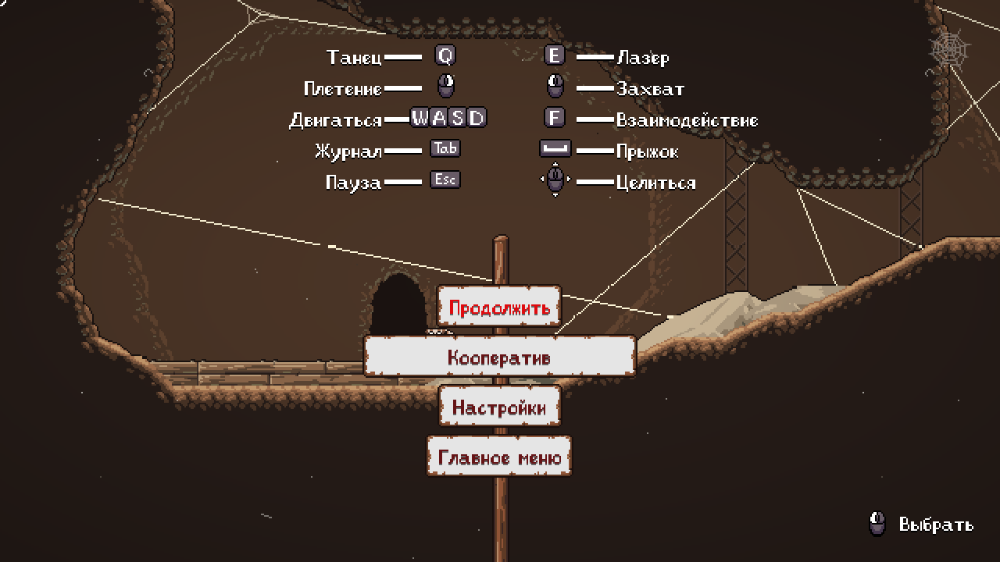
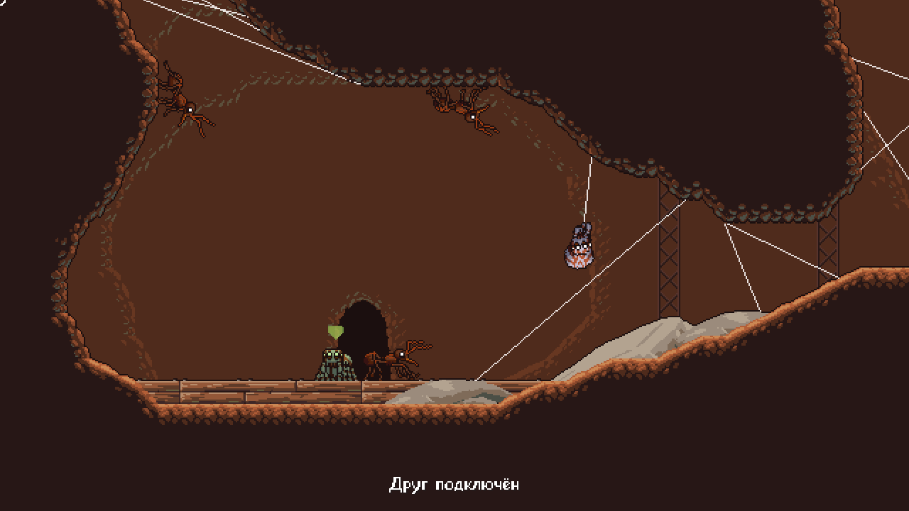
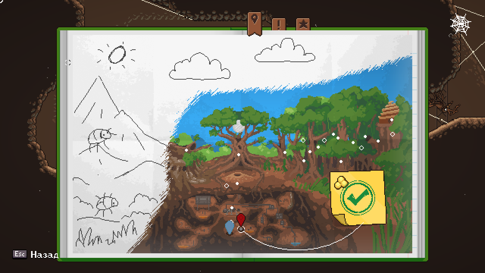

# Webbed Co-op

Неофициальный кооперативный мод для [Webbed](https://store.steampowered.com/app/1390350/Webbed/) на двоих через Steam.
Каждый управляет своим пауком, у каждого своя камера, паутина и физика общие, сюжет идёт по сохранению хоста.

**[Скачать установщик (Webbed-Coop-Setup.exe)](../../releases/latest)**



## Что умеет

- **Свой паук у каждого.** Пауки двигаются независимо, паутину, захват, плетение и разрезание видят оба, и всё это работает в общей физике.
- **Разные комнаты.** Каждый может уйти в свою комнату и вернуться к другу. Дверь переносит только того, кто в неё вошёл.
- **Общий сюжет.** Флаги истории, задачи, собранные предметы, наклейки, страницы журнала и состояние комнат сводятся в сохранение хоста. Выполненное задание не откатывается, а шаги одного квеста, сделанные двумя игроками параллельно, складываются.
- **Связь через Steam.** Соединение идёт через бесплатное приложение [Porthole](https://store.steampowered.com/app/4963920/) (сеть Steam с ретрансляторами), без LAN, VPN и проброса портов.
- **Сам находит друга.** Хост открывает мир, а друг нажимает «Войти к другу»: мод находит открытый мир среди друзей Steam. Можно и нажать «Присоединиться к игре» в списке друзей Steam. Для игрока не из друзей есть приглашение через буфер обмена.
- **Встроено в игру.** Пункт «Кооператив» стоит в главном меню и меню паузы рядом с «Настройками» и нарисован самой игрой: её таблички, шрифт, курсор и подсказки клавиш.
- **Друга видно.** Паук друга подкрашен в его цвет (у хоста зелёный, у гостя синий), над ним стрелка из интерфейса игры. Если друг за краем экрана или в другой комнате, у края экрана появляется стрелка в его сторону, а в журнале на карте стоит его булавка.

| Меню «Кооператив» | Паук друга | Карта в журнале |
|---|---|---|
|  |  |  |

## Установка

1. Нужна Windows-версия Webbed из Steam (сборка 7679547) и бесплатный [Porthole](https://store.steampowered.com/app/4963920/) из Steam. Установщик сам предложит поставить Porthole, если его нет.
2. Закройте игру и запустите `Webbed-Coop-Setup.exe`. Он находит игру во всех библиотеках Steam, проверяет её версию по контрольным суммам и делает резервную копию оригинального `data.win`.
3. Друг ставит тот же файл. Повторный запуск установщика предложит удалить мод: исходный `data.win` вернётся байт в байт.

## Как играть

1. **Хост** загружает своё сохранение, открывает паузу и выбирает **Кооператив → Открыть мир для друга**. Внизу появится «Мир открыт · друг войдёт через Steam».
2. **Друг** в главном меню или в паузе выбирает **Кооператив → Войти к другу**. Можно и нажать «Присоединиться к игре» на хосте в списке друзей Steam.
3. Если друга нет в списке друзей Steam: хост выбирает **Скопировать приглашение** и пересылает его, друг копирует текст и выбирает «Войти к другу».
4. Выйти: **Кооператив → Покинуть мир друга** (гость) или **Закрыть мир** (хост). Сюжет сохраняется у хоста. После выхода игра гостя перезапускается в его собственное меню, и его сохранения не затрагиваются.

## Как это устроено

- `src/` — нативная часть (C, x86). DLL подключается к игре как расширение GameMaker и перехватывает события объектов: ввод (`oIO`), игрока, камеру, журнал, HUD и меню `oMainMenu`. Пункт «Кооператив» добавляется в массивы `option_labels/option_scripts` самого меню, а подменю — это обычный экземпляр игрового `oMenu`.
- `helper/link.py` — сетевой модуль (`WebbedCoopLink.exe`). Через общую память получает от игры кадры пауков, физику паутины и изменения сохранения и обменивается ими по TCP. Хост слушает только `127.0.0.1` и открывает порт через `porthole expose` (анонимный режим, пароль из приглашения), гость подключается через `porthole connect`. Каждое сообщение подписано HMAC сеансовым ключом.
- `installer/` — установщик: находит игру, проверяет хеши, накладывает `resources.delta` на `data.win` (регистрация расширения) и кладёт DLL и сетевой модуль рядом с игрой.
- Временные файлы кооператива (`WebbedCoopSnapshot*.sav`, `WebbedCoopGuest*.sav`) лежат в папке, которую синхронизирует Steam Cloud, поэтому мод удаляет их сразу после использования и при запуске игры.

## Сборка

Нужны [Zig](https://ziglang.org/) (как компилятор C для `x86-windows-gnu`) и Python 3.11 с PyInstaller:

```powershell
.\build.ps1
```

Результат — `dist\Webbed-Coop-Setup.exe`.

## Ограничения

- Проверено на двух копиях игры на одном ПК через настоящий туннель Porthole/Steam: подключение, раздельные комнаты, паутина, предметы, сюжетный флаг, повторное подключение. Полное прохождение кампании вдвоём и игра на двух разных компьютерах через интернет пока не проверены.
- Частицы, часть звуков и анимации NPC считаются у каждого игрока локально и могут немного различаться.
- Работает только с указанной сборкой Webbed: после обновления игры мод откажется устанавливаться, а не сломает её.

## Лицензия

MIT, см. [LICENSE](LICENSE). Webbed принадлежит её авторам (Sbug Games). Мод не содержит файлов игры и требует купленную копию.
